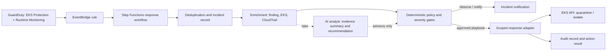

# Guarduty — AI Operations for EKS security incidents

Guarduty is a learning project for an incident operations loop on Amazon EKS:

**Detect → Analyze → Contain → Verify → Learn**

The first milestone uses Amazon GuardDuty findings and deterministic, auditable response workflows. AI may help summarize evidence and recommend a playbook, but it does not choose or execute destructive actions in the MVP. This keeps the project useful for an AI Ops direction while making incident response predictable and reviewable.

> Current status: architecture and implementation plan. No AWS resources are provisioned by this repository yet.

## Project goals

- Demonstrate EKS threat detection using GuardDuty EKS Protection and, where supported, Runtime Monitoring.
- Explain an incident by preserving the original finding and enriching it with cluster, namespace, workload, pod, process, and timeline context.
- Automate a small set of reversible, scoped containment actions with idempotency, audit records, and a recovery path.
- Measure detection-to-containment time and record false positives and action outcomes.
- Add an AI analyst only after deterministic event processing and response controls work end to end.

## Initial demo path

1. Provision a disposable EKS lab and enable GuardDuty protection plans.
2. Confirm Runtime Monitoring coverage is healthy if that plan is enabled.
3. Run the AWS Container Security workshop's EKS attack-sequence exercise in the lab account.
4. Capture the resulting finding and its resource details; correlate it with EKS audit/runtime evidence.
5. Send the finding through EventBridge to a workflow that records, enriches, and classifies it.
6. In the first iteration, run in **observe-only** mode. Then enable a narrowly scoped quarantine action in the disposable lab and verify the action and rollback.

Use the AWS workshop instructions and approved test activity only in an isolated account and cluster. Do not run the attack simulation against production workloads.

## Proposed architecture

A state machine is proposed over a single Lambda so retries, timeouts, branching, and action outcomes are explicit. The response adapter should use a dedicated IAM role, least privilege, EKS access entries/RBAC scoped to the target namespace, and an allow-listed action set. Do not grant cluster-admin to the automation role.

## Safety and response policy

| Finding / context | MVP behavior | Later automation candidate |
|---|---|---|
| Any finding, unknown resource, or incomplete context | Record and notify; no mutation | Keep observe-only until policy is explicit |
| Critical `AttackSequence:EKS/CompromisedCluster` in demo cluster | Enrich and notify; simulate action first | Quarantine only the identified workload, then verify |
| Runtime finding on a production-like cluster | Notify and preserve evidence | Require an approval gate before containment |
| Agent coverage becomes unhealthy | Alert on coverage gap | Never treat missing telemetry as a clean bill of health |
| Duplicate/replayed finding | Deduplicate using finding ID and action key | Do not repeat a completed containment action |

Containment options must be evaluated per cluster networking and workload ownership. Deleting all pods in a namespace is not a safe general remediation: controllers may recreate them, evidence may be lost, and unrelated services may be affected. Prefer a scoped, reversible quarantine (for example, a NetworkPolicy where the cluster CNI supports the intended semantics), followed by verification and a documented rollback. Node isolation or workload shutdown is a later, higher-impact playbook.

## Repository layout

- `docs/architecture.md` — components, trust boundaries, and event flow.
- `docs/research.md` — current AWS terminology, workshop findings, and open questions.
- `docs/roadmap.md` — staged project plan and acceptance criteria.
- `docs/response-playbooks.md` — proposed actions, gates, verification, and rollback.
- `docs/adr/0001-deterministic-response-first.md` — why the MVP does not let an LLM execute actions.
- `examples/eventbridge-attack-sequence-pattern.json` — starter event filter; validate it against real account events before use.
- `infra/dev/` — Terraform lab stack for VPC, EKS, GuardDuty, EventBridge, and an observe-only incident Lambda.

## Planned implementation

1. Validate the workshop scenario and real event payload in an isolated AWS account.
2. Review and plan the Terraform lab foundation in `infra/dev/`; it creates VPC, EKS, GuardDuty configuration, EventBridge, IAM, logging, and an observe-only Lambda.
3. Add a deterministic incident handler with a dry-run mode, deduplication, and audit trail.
4. Add one reversible containment playbook and its verification/rollback path.
5. Evaluate AI-assisted summaries and recommendations against recorded incidents; keep action authorization outside the model.

## Non-goals for the first milestone

- Autonomous arbitrary `kubectl` commands or LLM-selected AWS API calls.
- Broad cluster-admin permissions for Lambda or Step Functions.
- Automatic destructive remediation in production.
- Claiming that a finding alone proves root cause. Findings are evidence; enrich and correlate before assigning a cause.

## Sources

See [docs/research.md](docs/research.md) for the source list and what each source informs.
