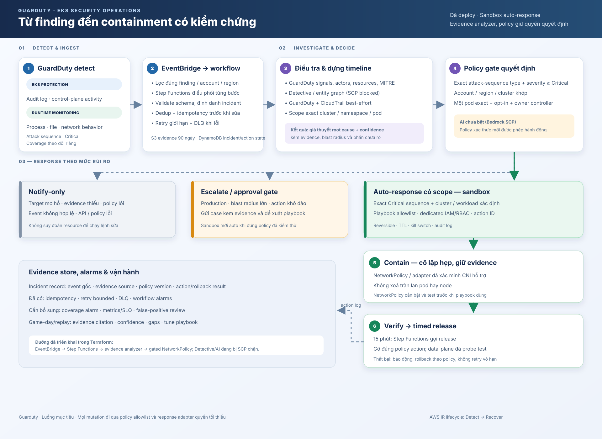

# Guarduty

**Guarduty** là lab AI Ops cho bảo mật Amazon EKS. Dự án nhận finding từ Amazon GuardDuty, phân tích evidence, áp dụng policy xác định và có thể tự cô lập workload demo bằng Kubernetes NetworkPolicy.

> **Trạng thái:** lab MVP đang chạy tại `us-east-1`. Không dùng cấu hình này cho production.

[](https://aws.amazon.com/guardduty/)
[](https://developer.hashicorp.com/terraform)

## Mục tiêu

```text
Detect → Analyze → Decide → Contain → Verify / Release
```

- **Detect:** GuardDuty EKS Protection và Runtime Monitoring quan sát hoạt động trên cluster.
- **Analyze:** workflow lấy finding chuẩn từ GuardDuty, trích signals, resources và MITRE indicators; CloudTrail enrichment là best-effort.
- **Decide:** policy deterministic kiểm tra account, region, cluster, finding type/severity và workload target.
- **Contain:** response adapter có quyền Kubernetes giới hạn, tạo NetworkPolicy cho đúng pod đã opt-in trong namespace `guarduty-demo`.
- **Release:** Step Functions gỡ policy sau 15 phút. AI và Amazon Detective chưa hoạt động trong account hiện tại.



## Trạng thái triển khai

| Thành phần | Trạng thái |
|---|---|
| EKS, VPC, hai worker node | Đã deploy tại `us-east-1` |
| GuardDuty EKS Protection và Runtime Monitoring | Đã bật; coverage gần nhất healthy cho 1 EKS và 2 EC2 |
| EventBridge → Step Functions → analyzer | Đã deploy; sample tổng hợp đi qua workflow và được đánh dấu duplicate |
| Evidence | S3 mã hoá, retention 90 ngày; DynamoDB mã hoá, PITR và TTL 90 ngày |
| Sandbox quarantine | NetworkPolicy adapter đã kiểm chứng bằng probe mạng và rollback |
| Reduced runtime simulation | Đã chạy HTTP, một cổng TCP và truy vấn Kubernetes API có giới hạn; đã xoá namespace |
| Attack sequence workshop end-to-end | Chưa chạy; mô phỏng giới hạn không tạo finding mới trong lần quan sát này |
| Amazon Detective và Bedrock | Bị AWS Organizations SCP chặn |
| SNS nhận alarm | Topic đã tạo; chưa có subscription |

Analyzer hiện tạo **root-cause hypothesis** có evidence và evidence gaps; đây chưa phải kết luận forensic hay AI analysis. Workflow chỉ tự quarantine khi các điều kiện allowlist khớp. Sample finding ngoài account/cluster lab đã rẽ sang `NOTIFY_ONLY`.

Có thể xem cách chạy và dọn bài [mô phỏng runtime giới hạn](examples/safe-eks-runtime-simulation/README.md). Bài này không đại diện cho toàn bộ attack sequence của AWS workshop.

## Bắt đầu

### Điều kiện cần

- AWS CLI và credentials hợp lệ cho account sandbox.
- Terraform `1.13.x`.
- `kubectl`.
- Quyền cần thiết để tạo VPC, EKS, GuardDuty, IAM, Lambda và các dịch vụ liên quan.

Profile mặc định của project là `guru`, region là `us-east-1`. Kiểm tra identity trước khi chạy Terraform:

```bash
aws sts get-caller-identity --profile guru
```

### Deploy vào AWS sandbox mới

Stack hiện có trong account dự án; Terraform state được giữ local và **chưa có backend dùng chung**. Chỉ dùng các lệnh dưới đây trong account sandbox mới hoặc sau khi đã cấu hình/import đúng state. Không chạy `apply` trong account đang có stack nếu chưa quản lý state tương ứng.

```bash
cd infra/dev
cp terraform.tfvars.example terraform.tfvars
```

Sửa `allowed_cidr_blocks` trong `terraform.tfvars` thành địa chỉ IP public của bạn dạng `/32`. Sau đó chạy:

```bash
terraform init
terraform fmt -check -recursive
terraform validate
terraform plan -var-file=terraform.tfvars -out=dev.tfplan
terraform apply dev.tfplan
```

Đọc plan trước khi apply, nhất là account, region, EKS endpoint CIDR, số node và tài nguyên GuardDuty. Hướng dẫn kết nối cluster, kiểm tra deployment và huỷ lab nằm trong [hướng dẫn môi trường dev](infra/dev/README.md).

## Chi phí và an toàn

EKS control plane, EC2, NAT Gateway, GuardDuty, CloudWatch, lưu trữ và data transfer có thể tính phí. Lab giữ nguyên tài nguyên AWS cho đến khi huỷ; hãy kiểm tra và teardown khi không còn dùng.

- Không commit `terraform.tfvars`, state, plan, credentials hoặc finding/evidence thật.
- Không mở EKS API public cho `0.0.0.0/0`.
- Chỉ bật auto-remediation trong sandbox đã kiểm tra workload và NetworkPolicy.
- NetworkPolicy quarantine không thay thế eradication, recovery hoặc điều tra forensic.
- SNS topic cần subscription để alarm được gửi tới người vận hành.

## Cấu trúc repository

```text
.
├── README.md                    # Điểm vào dự án, trạng thái và quick start
├── CONTRIBUTING.md              # Quy tắc thay đổi code và Terraform
├── .editorconfig                # Quy ước thụt lề và encoding
├── docs/
│   ├── README.md                # Chỉ mục tài liệu
│   ├── architecture.md          # Thành phần, luồng dữ liệu và ranh giới quyền
│   ├── incident-response-flow.md
│   ├── incident-response-flow.svg
│   ├── response-playbooks.md    # Hành động và điều kiện containment
│   ├── research.md              # AWS docs, dự án tham khảo và cơ hội cải tiến
│   ├── roadmap.md               # Trạng thái và phần việc tiếp theo
│   └── adr/                     # Quyết định kiến trúc đã ghi nhận
├── examples/
│   ├── eventbridge-attack-sequence-pattern.json
│   └── safe-eks-runtime-simulation/ # Lab giới hạn, có hướng dẫn cleanup
└── infra/
    ├── README.md                # Chỉ mục hạ tầng
    └── dev/                     # Terraform root module cho lab hiện tại
        ├── lambda/              # Analyzer và response adapter
        ├── main.tf              # VPC, EKS, GuardDuty và event rule
        ├── workflow.tf          # Step Functions, IAM, storage, alarms
        ├── variables.tf
        ├── outputs.tf
        └── versions.tf          # Terraform/provider constraints
```

`infra/dev` hiện là một Terraform root module có chủ đích. Khi xuất hiện môi trường thứ hai hoặc tài nguyên cần dùng lại, có thể tách thành `modules/` với ranh giới rõ; chưa tạo module trừu tượng khi chỉ có một consumer.

## Tài liệu

- [Chỉ mục tài liệu](docs/README.md)
- [Kiến trúc và trust boundaries](docs/architecture.md)
- [Luồng ứng phó sự cố](docs/incident-response-flow.md)
- [Response playbooks](docs/response-playbooks.md)
- [Nghiên cứu và cơ hội cải tiến](docs/research.md)
- [Roadmap và giới hạn hiện tại](docs/roadmap.md)
- [Terraform lab: deploy, verify, destroy](infra/dev/README.md)
- [Đóng góp và quy ước repo](CONTRIBUTING.md)

## AWS references

- [GuardDuty Extended Threat Detection](https://docs.aws.amazon.com/guardduty/latest/ug/guardduty-extended-threat-detection.html)
- [GuardDuty findings qua EventBridge](https://docs.aws.amazon.com/guardduty/latest/ug/guardduty_findings_eventbridge.html)
- [GuardDuty Runtime Monitoring](https://docs.aws.amazon.com/guardduty/latest/ug/runtime-monitoring.html)
- [EKS VPC CNI NetworkPolicy](https://docs.aws.amazon.com/eks/latest/userguide/cni-network-policy.html)
- [Workshop: Generate and Respond to an EKS Attack Sequence](https://catalog.workshops.aws/containersecurity/en-US/module5/module5-3/module5-3-2)
