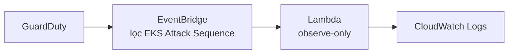
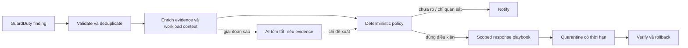

<div align="center">

# Guarduty

### AI Operations cho phát hiện và ứng phó sự cố trên Amazon EKS

**Detect → Analyze → Contain → Verify → Learn**

[](https://aws.amazon.com/guardduty/)
[](https://developer.hashicorp.com/terraform)
[](docs/roadmap.md)

Repo học tập của DSO-Team5: dựng lab EKS, nhận diện finding GuardDuty và xây dần quy trình phân tích, phản ứng có kiểm soát.

</div>

---

## Trạng thái hiện tại

**Đã có:** Terraform tạo VPC, EKS, GuardDuty EKS Protection/Runtime Monitoring và luồng finding `AttackSequence:EKS/CompromisedCluster` qua EventBridge đến Lambda.

**Lambda hiện chỉ ghi nhận finding (observe-only).** Nó chưa phân tích nguyên nhân đầy đủ và chưa thay đổi workload. Tự động cô lập workload và AI hỗ trợ phân tích nằm trong các giai đoạn tiếp theo.

## Bắt đầu nhanh

> Đây là lab có tính phí. Hãy dùng AWS account riêng, giới hạn IP truy cập EKS và xoá tài nguyên sau khi thử nghiệm.

```bash
cd infra/dev
cp terraform.tfvars.example terraform.tfvars
```

Mở `terraform.tfvars`, thay `allowed_cidr_blocks` bằng IP public hiện tại của bạn dạng `/32`. Chọn phiên bản Kubernetes còn được hỗ trợ tại region đã cấu hình (`ap-southeast-1`). Sau đó:

```bash
terraform init
terraform plan -var-file=terraform.tfvars
```

Đọc kỹ plan trước khi triển khai. Chỉ chạy `terraform apply` khi đã xác nhận account, region, IP truy cập và chi phí. Hướng dẫn cấu hình AWS CLI profile `guru`, kết nối `kubectl` và huỷ lab nằm trong [hướng dẫn Terraform](infra/dev/README.md).

### Chi phí cần lưu ý

EKS control plane, EC2 worker nodes, NAT Gateway, GuardDuty, CloudWatch Logs và data transfer có thể tính phí. Cấu hình mặc định dùng một NAT Gateway để giảm chi phí; đây không phải thiết kế HA cho production.

## Kiến trúc

### Luồng đã được Terraform dựng



### Hướng phát triển



AI không được tự cấp quyền hoặc gọi lệnh thay đổi cluster. Policy xác định hành động; nếu thiếu ngữ cảnh, hệ thống phải chuyển sang cảnh báo thay vì tự sửa.

## Lộ trình

| Giai đoạn | Mục tiêu | Trạng thái |
|---|---|---|
| 1. Detection | Dựng EKS lab, bật GuardDuty, thử attack-sequence workshop | Terraform nền tảng đã có; cần chạy lab |
| 2. Analysis | Giữ finding gốc, bổ sung context, correlate timeline | Đang thiết kế |
| 3. Response | Tự động quarantine hẹp, có kiểm tra và rollback | Chưa triển khai |
| 4. AI Ops | Tóm tắt evidence và đề xuất playbook; policy vẫn kiểm soát quyền | Chưa triển khai |

Chi tiết acceptance criteria ở [roadmap](docs/roadmap.md).

## Cấu trúc repo

```text
infra/dev/       Terraform cho lab AWS
  lambda/        Handler nhận GuardDuty finding, chỉ ghi log
  *.tf           VPC, EKS, GuardDuty, EventBridge, IAM, Lambda
  README.md      Cách cấu hình, deploy và destroy

docs/            Kiến trúc, nghiên cứu, playbook và roadmap
examples/        EventBridge event pattern mẫu
```

## Tài liệu

- [Hướng dẫn Terraform lab](infra/dev/README.md)
- [Kiến trúc và trust boundaries](docs/architecture.md)
- [Nghiên cứu GuardDuty và cơ hội cải tiến](docs/research.md)
- [Response playbooks](docs/response-playbooks.md)
- [Roadmap và tiêu chí hoàn thành](docs/roadmap.md)
- [ADR: deterministic response trước AI execution](docs/adr/0001-deterministic-response-first.md)

## Nguồn AWS chính

- [GuardDuty Extended Threat Detection](https://docs.aws.amazon.com/guardduty/latest/ug/guardduty-extended-threat-detection.html)
- [GuardDuty findings qua EventBridge](https://docs.aws.amazon.com/guardduty/latest/ug/guardduty_findings_eventbridge.html)
- [GuardDuty Runtime Monitoring](https://docs.aws.amazon.com/guardduty/latest/ug/runtime-monitoring.html)
- [Workshop: Generate and Respond to an EKS Attack Sequence](https://catalog.workshops.aws/containersecurity/en-US/module5/module5-3/module5-3-2)

---

<div align="center">

**DSO-Team5 · Guarduty AI Ops**

</div>
