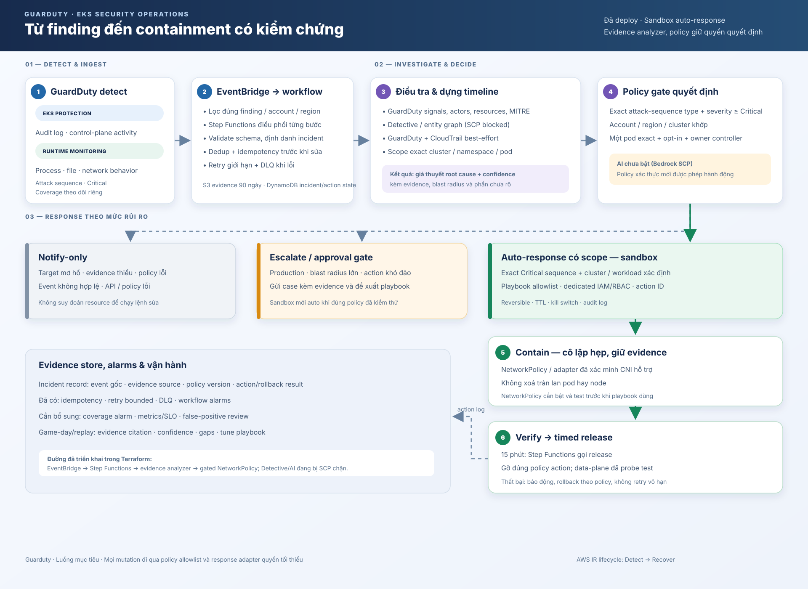

# Luồng phát hiện và ứng phó sự cố EKS

Sơ đồ thể hiện luồng Guarduty tại `us-east-1`. Terraform deploy GuardDuty → EventBridge → Step Functions → analyzer; evidence lưu S3/DynamoDB; policy hẹp có thể gọi response Lambda để quarantine pod opted-in bằng NetworkPolicy trong 15 phút rồi tự release. EventBridge có rule riêng cho EKS attack sequence và Runtime Monitoring. DNS canary tạo finding runtime thật; pattern đã match và state machine replay đã trích evidence, chọn `NOTIFY_ONLY` rồi publish structured message vào SNS thành công. Topic chưa có subscriber. Sample finding giả lập ngoài account/cluster lab cũng đi `NOTIFY_ONLY`. NetworkPolicy data-plane đã được kiểm chứng bằng probe trong demo namespace và rollback. Workshop attack sequence thực tế chưa chạy.

## Các bước trong luồng

| Bước | Việc xảy ra | Quy tắc thiết kế |
|---|---|---|
| 1. Detect | GuardDuty EKS Protection thu tín hiệu audit log; Runtime Monitoring bổ sung hành vi process/network/file. Extended Threat Detection tương quan tín hiệu thành `AttackSequence:EKS/CompromisedCluster`. | GuardDuty coverage có thể kiểm tra; alarm tự động cho coverage unhealthy chưa được nối vào stack này. Hạn chế suppression/archive rộng vì archived findings không được dùng làm tín hiệu cho attack sequence. |
| 2. Ingest | Rule riêng chuyển EKS attack sequence và EKS Runtime Monitoring findings vào workflow. | Validate account, region, finding ID, type và schema. Có retry, DLQ, deduplication và idempotency trước mọi mutation. Lưu event gốc và audit trail có retention. |
| 3. Analyze | Analyzer lấy sequence actors/resources/signals/MITRE hoặc Runtime Monitoring process, instance, cluster, pod, container và DNS context; CloudTrail lookup theo IAM actor là best-effort. Runtime canary đã được replay qua analyzer. Response adapter kiểm tra pod labels/owner/hostNetwork trước containment. Detective finding groups chưa khả dụng vì Organizations SCP chặn `detective:ListGraphs`. | Finding là bằng chứng đầu vào, không tự nó chứng minh root cause. Giữ nguồn và thời điểm của từng evidence; thiếu context phải giảm confidence. Detective có độ trễ tích luỹ dữ liệu, nên không chặn containment khẩn cấp chỉ để đợi group. |
| 4. Decide | Policy hiện xét finding type/severity, account, region, cluster, namespace, workload exact và chế độ auto; adapter kiểm tra pod opt-in, owner controller và hostNetwork. | Policy xác thực và version-controlled là nơi duy nhất cấp quyền. Coverage-health, confidence scoring và AI chưa phải gate hoạt động trong bản lab hiện tại; thiếu/không khớp các gate hiện có thì không remediation. |
| 5. Contain | Với finding Critical, target xác định rõ trong sandbox và playbook đã bật, workflow tự động cô lập workload bằng action hẹp, có thời hạn. | Ưu tiên reversible containment và giữ pod/evidence để điều tra. Không xoá hàng loạt pod hay node. EKS NetworkPolicy chỉ dùng khi VPC CNI/network-policy feature đã bật và test đúng CNI/OS/address family/traffic paths. |
| 6. Eradicate & recover | Loại bỏ workload/image/credential bị xâm phạm, sửa cấu hình gốc, triển khai workload sạch, khôi phục traffic và theo dõi tái phát. | Tách containment tạm thời khỏi remediation lâu dài. Xoay vòng credential liên quan; đối chiếu với Git/IaC trước khi đưa cluster về trạng thái chuẩn. |
| 7. Verify & learn | Xác nhận policy có hiệu lực, dịch vụ liên quan hoạt động, finding không tái diễn; ghi lại action/rollback và metrics. | Có TTL/rollback, kill switch, dead-letter alert và replay test. Đo thời gian detect/analyze/contain, tỷ lệ hành động lỗi và false positive. |

## Nhánh quyết định

- **Tự động trong sandbox:** finding loại đã allowlist, cluster lab đã allowlist, target workload rõ ràng, policy version hợp lệ và response adapter còn healthy. Action giới hạn trong scope đó, có TTL và verify.
- **Approval hoặc escalation:** target rõ nhưng blast radius lớn, production-like environment, action có nguy cơ gián đoạn hoặc credential có thể dùng ở nhiều workload.
- **Notify-only:** finding không rõ target, evidence thiếu/mâu thuẫn, coverage unhealthy, event sai schema, hoặc lỗi enrichment/policy. Không suy đoán resource rồi thay đổi cluster.

Mục tiêu “without human intervention” áp dụng cho playbook sandbox đã được định nghĩa và kiểm chứng. Với production, mức tự động hoá cần cấu hình theo risk appetite; không nên biến mô hình AI thành ranh giới phân quyền.

## Root cause analysis và AI

GuardDuty Extended Threat Detection tạo một finding từ chuỗi tín hiệu; Detective hỗ trợ điều tra quan hệ giữa findings và entities, bao gồm Kubernetes API activity, cluster, image/container và dữ liệu audit khi đã bật nguồn phù hợp. Workflow nên tạo **root-cause hypothesis** có evidence, confidence, affected scope và evidence gaps — không ghi một kết luận chắc chắn khi dữ liệu chưa đủ.

Khi được cấp quyền model, AI có thể tạo bản tóm tắt incident theo mẫu. Hiện Bedrock bị Organizations SCP chặn (`ListFoundationModels`/`InvokeModel`), nên workflow chưa gọi AI; analyzer hiện tạo giả thuyết theo luật và ghi rõ evidence gaps. Mẫu tóm tắt dự kiến:

1. Điều gì đã xảy ra và mốc thời gian nào hỗ trợ nhận định đó?
2. Resource / principal / workload nào bị ảnh hưởng?
3. Evidence nào ủng hộ hoặc mâu thuẫn với giả thuyết root cause?
4. Chưa biết điều gì? Mức confidence ra sao?
5. Playbook nào phù hợp và action nào policy cho phép?

Mỗi nhận định của AI phải trỏ về evidence ID/field. Policy engine kiểm tra lại action độc lập với nội dung AI.

## Tham khảo dự án

- [AWS GuardDuty Automated Response Sample](https://github.com/aws-samples/amazon-guardduty-automated-response-sample): tham khảo EventBridge, Step Functions và Lambda orchestration. Sample hướng tới EC2; không bê nguyên remediation sang EKS.
- [AWS Incident Response Playbooks](https://github.com/aws-samples/aws-incident-response-playbooks): tham khảo cấu trúc triage/playbook, có kịch bản Container/EKS compromise và automation patterns.
- [AWS EKS Container Security Workshop, module 5.3.2](https://catalog.workshops.aws/containersecurity/en-US/module5/module5-3/module5-3-2): tạo EKS attack sequence để kiểm chứng detection flow.

## Tài liệu AWS

- [GuardDuty Extended Threat Detection](https://docs.aws.amazon.com/guardduty/latest/ug/guardduty-extended-threat-detection.html)
- [GuardDuty attack sequence finding types](https://docs.aws.amazon.com/guardduty/latest/ug/guardduty-attack-sequence-finding-types.html)
- [GuardDuty findings qua EventBridge](https://docs.aws.amazon.com/guardduty/latest/ug/guardduty_findings_eventbridge.html)
- [Amazon Detective finding groups](https://docs.aws.amazon.com/detective/latest/userguide/groups-about.html)
- [Analyze EKS security events with Detective](https://docs.aws.amazon.com/eks/latest/userguide/integration-detective.html)
- [AWS Security Incident Response: containment](https://docs.aws.amazon.com/security-ir/latest/userguide/contain.html)
- [AWS Well-Architected: automate response to events](https://docs.aws.amazon.com/wellarchitected/2023-10-03/framework/sec_detect_investigate_events_auto_response.html)
- [EKS NetworkPolicy prerequisites and limitations](https://docs.aws.amazon.com/eks/latest/userguide/cni-network-policy.html)
